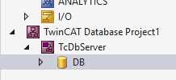
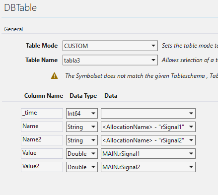
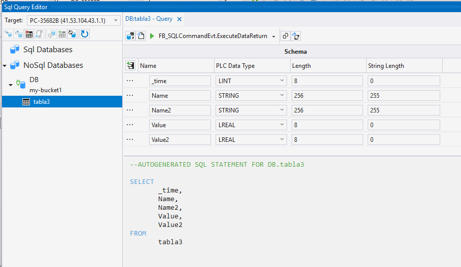
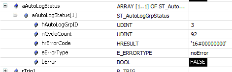

# Ejemplo de publicación de datos de plc a InfluxDB y visualización con Grafana desde TwinCAT HMI

## Descripción

El proyecto publica unas señales generadas desde el plc, una señal de dientes de sierra y otra senoidal. Para publicar hacia InfluxDB se usa la function TF6420 DatabaBase Server de TwinCAT. Esta funcionalidad permite conectar con bases de datos en modos diferentes. El utilizado en este ejemplo es el modo 'Autolog'. Esto permite seleccionar qué símbolos de plc publicar e idicar el intervalo de publicación.

## Requisitos

Testeado con las siguientes versiones:
TwinCAT 4026.20
Función TF6420 v34.37.2
HMI Engineering/Server v14.13.1
InfluxDB 2 v2.8.0
Grafana v13.1

Licencias necesarias (en todas ellas las licencias Trial son válidas):
TF1200 PLC
TF6420 Database
TF2000 HMI

## Configurar TF6420 Database

Se añade a la solución del proyecto de TwinCAT un proyecto TwinCAT Conectivity Database

Se puede configurar para que la publicación se haga de manera automática al arrancar el programa de plc o bien controlándolo desde el método Start() del bloque FB_PLCDBAutologEvt. En este ejemplo se hace de esta última manera activando la variable **bAutologStart**.

## Visualización de datos de Grafana embebido en TwinCAT HMI

Para incrustrar una visualización del dashboard de Grafana, en Content de HMI se añade un objeto iFrame. Desde el dashboard de Grafana se puede compartir el dashboard desde el menú Share public. Hay que copiar el texto html dentro del editor html del objeto iFrame del hmi.

Es importante indicar en el enlace http la dirección IP del servidor de Grafana, no permite indicar localhost.

## Diagnóstico

En el programa de plc se usa una llamada cíclica al método Status del bloque FB_PLCDBAutolog para consultar el estado de la conexión. Este método devuelve el número de peticiones y el código de estado de la conexión. Si se pierde la conexión con la base de datos el valor del parámetro hrErrorCode es 16#989103E8.

